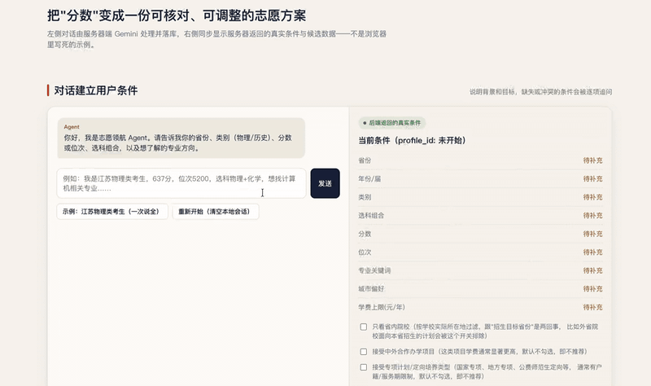
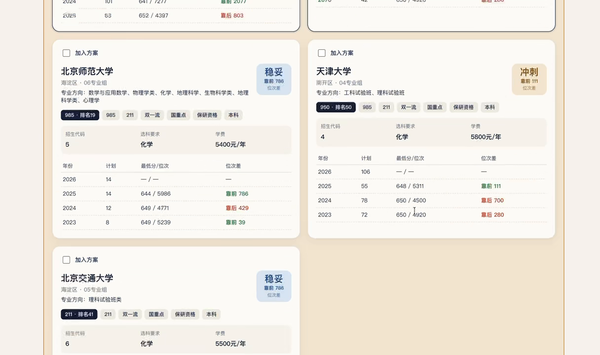
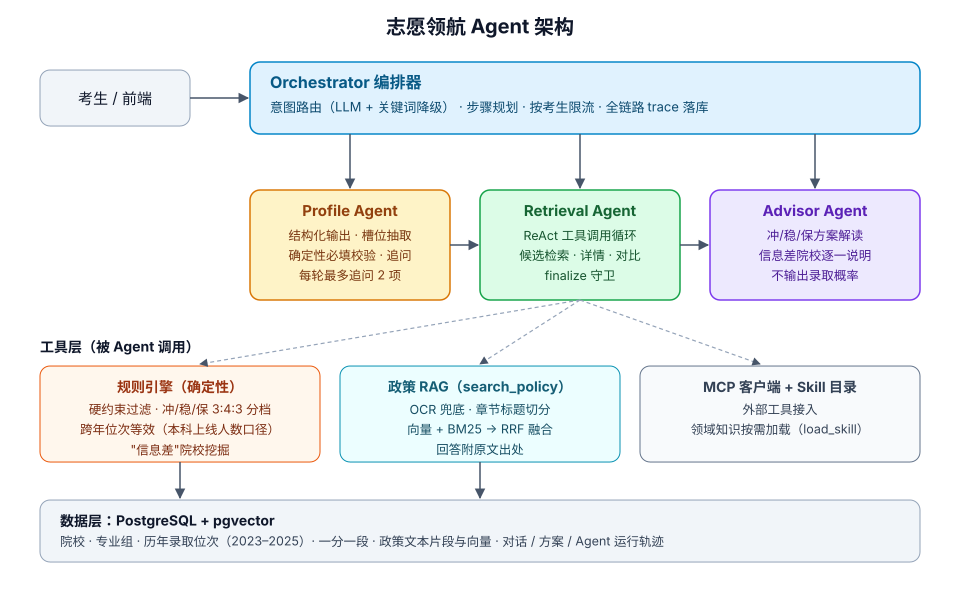

# 志愿领航 Agent

[English](README_EN.md) · 中文

   

> 基于**多智能体 + RAG** 的高考志愿规划助手：通过对话理解考生情况，用规则引擎给出"冲 / 稳 / 保"分档，并从政策原文中检索带出处的依据，还能挖掘被忽视的"信息差"院校。



> 演示：输入一句话 → 自动提取条件 → 查询候选 → 冲/稳/保分档，并提示被忽视的“信息差”院校。数据为作者整理的江苏数据，仅供实验。

## 为什么做这个

志愿填报要同时处理跨年位次换算、选科限制、院校分档和大量政策条款，信息分散；考生又常常只盯热门城市，忽略非热门城市里的 985/211/双一流。直接问通用大模型，容易得到编造的录取数据和没有依据的"录取概率"。

本项目的思路是：**让模型负责理解与解释，让规则和检索负责事实**。

## 核心特性

- **多 Agent 编排**：Orchestrator 做意图路由（LLM + 关键词降级）、步骤规划、限流和全链路 trace；Profile / Retrieval / Advisor 三个 Agent 分工协作。
- **可控的 ReAct 工具调用**：Retrieval / Advisor 通过工具检索候选、对比、查政策。`finalize_recommendation` 守卫保证推荐必须经规则引擎校验后才能输出。
- **确定性规则引擎**：硬约束过滤、冲/稳/保 3:4:3 分档、跨年位次等效（以"本科上线人数"为口径）、"信息差"院校挖掘。
- **政策 RAG**：扫描件 OCR 兜底，按章节标题切分，pgvector 向量检索与 BM25 经 RRF 融合，回答附原文出处。
- **MCP + Skill**：可接入外部工具，领域知识按需加载。
- **分层评测**：槽位抽取 F1、硬约束、分档结构、历史回测、LLM-as-Judge。





## 评测结果

| 项目 | 结果 | 说明 |
|---|---|---|
| 政策 RAG（hit@1） | 76.3% → 89.5% | 纯向量基线 → 章节切分 + 向量/BM25 RRF 融合；hit@5 92.1% → 100%，MRR 0.935 |
| 历史回测（保底档） | 录取率 95.3% | 无数据泄漏，以 2025 年为验证年 |
| 槽位抽取 | F1 0.999 | 200 条用例 |
| LLM-as-Judge | 与人工一致率 96.9% | 32 条人工标注样本校准，无漏判 |

> 这些数字有明确的局限，请不要过度解读：RAG 评测集只有 42 题、2 份政策文件，2 题以内的差距属于噪声；槽位用例约 1/3 为模板生成且未经人工复核、偏江苏；裁判校准仅 32 条样本；回测保底档没有达到最初设定的 99.5%，产品标准定为 95%。详见 [backend/tests/eval/README.md](backend/tests/eval/README.md)。RAG 评测依赖的政策原文不随仓库发布，需自行准备。

## 快速开始

需要：Docker（含 Compose），以及一个 [Gemini API Key](https://aistudio.google.com/apikey)。

```bash
git clone https://github.com/你的用户名/仓库名.git
cd 仓库名

# 1. 配置密钥（写进项目根目录的 .env，不会被提交）
printf "JWT_SECRET=$(python3 -c 'import secrets;print(secrets.token_urlsafe(32))')\nGEMINI_API_KEY=你的key\n" > .env

# 2. 启动
docker compose up -d --build

# 3. 建表并导入数据（院校/专业组/历年录取/一分一段 + 政策向量库）
docker compose exec backend alembic upgrade head
docker compose exec db psql -U postgres -d gaokao_agent -f /data/jiangsu_admission_data.sql
docker compose exec db psql -U postgres -d gaokao_agent -f /data/policy_vectors.sql
docker compose exec db psql -U postgres -d gaokao_agent -f /data/post_import.sql
```

打开 http://localhost:8080 ，点"示例：江苏物理类考生"，发送，按提示补全信息后查询候选。接口文档在 http://localhost:8000/docs 。

> Docker 方式我没有在所有环境下逐一验证，如遇问题欢迎提 Issue。不用 Docker 的本地运行方式（本地 PostgreSQL + pgvector、虚拟环境）见 [docs/development-notes.md](docs/development-notes.md)。

## 数据说明

仓库附带江苏省的招生数据（作者自行搜集整理，**仅用于实验和学习研究**，约 4.7 MB）和政策向量库，**不构成志愿填报建议，请以官方发布为准**。政策原文不随仓库发布，只提供向量库。详见 [data/DATA.md](data/DATA.md)。数据库目前只覆盖江苏，其他省份无数据。

## 项目结构

```
backend/app/services/   编排器、各 Agent、规则引擎、RAG、MCP 客户端
backend/app/api/        FastAPI 接口
backend/alembic/        数据库迁移
backend/tests/          单元测试与评测（tests/eval）
frontend/               原生 HTML/JS 前端（无构建步骤）
data/                   示例数据与政策向量库
docs/                   架构图与开发笔记
```

## 已知局限

- 只有江苏数据；非江苏的对话用例只能测试理解能力，不能给出推荐。
- 项目是 demo 阶段，没有真实用户验证，规则（如 3:4:3 配额）是经验设定。
- 前端是单页原型，交互较简单。

## 许可

代码采用 [MIT](LICENSE)。数据仅限学习、研究和非商业用途，见 [data/DATA.md](data/DATA.md)。
